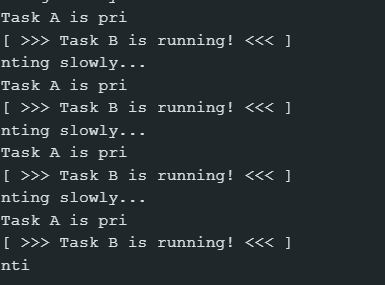

# FreeRTOS Scheduler & Preemption Demonstration

## 1. Purpose
Investigate how the FreeRTOS preemptive scheduler selects tasks, manages task states (Running, Ready, Blocked), handles priorities, and manages inter-task notifications.

## 2. Hardware and Software
* **Board:** ESP32-S3-DevKitC-1 v1.1
* **Software:** Arduino IDE 2.x
* **Baud Rate:** 115200

## 3. Test Scenarios
All tests run with both tasks pinned to **Core 1**:
* **Scenario A:** Task A Priority = 1, Task B Priority = 2
* **Scenario B:** Task A Priority = 1, Task B Priority = 1
* **Scenario C:** Task A Priority = 1, Task B Priority = 3

## 4. Prediction and Observation Table

| Scenario | Prediction Before Test | Actual Observation | Match? Why? |
| :--- | :--- | :--- | :--- |
| **A: Task B Priority = 2** | Task B will immediately preempt Task A when notified mid-sentence because Priority 2 > Priority 1. | Task B output appeared directly inside Task A's printed message line. | **Yes.** Preemptive scheduler forces immediate context switch to higher priority Ready task. |
| **B: Task B Priority = 1** | Task B will NOT preempt Task A mid-sentence because priorities are equal. Task B will wait until Task A yields/blocks. | Task A completed its sentence before Task B printed its line. | **Yes.** Equal-priority tasks do not preempt a currently Running task on the same core until it yields or blocks. |
| **C: Task B Priority = 3** | Task B will immediately preempt Task A mid-sentence because Priority 3 > Priority 1. | Task B interrupted Task A immediately upon notification, exactly like Scenario A. | **Yes.** Any higher-priority Ready task immediately preempts a lower-priority Running task. |

## 5. Scheduler Behaviour Explanation

FreeRTOS tasks exist in three main states:
* **Running:** The task currently occupying the CPU core.
* **Blocked:** A task waiting for an event or time delay (occupies 0% CPU).
* **Ready:** A task able to execute, waiting for the scheduler to grant it CPU time.

Initially, Task B enters the **Blocked** state because `ulTaskNotifyTake()` pauses execution until a notification arrives. Task A is in the **Running** state, printing characters slowly. 

When Task A calls `xTaskNotifyGive()`, Task B receives the notification and transitions from **Blocked** to **Ready**. In Scenarios A and C, because Task B's priority is higher than Task A's priority, the FreeRTOS preemptive scheduler immediately halts Task A, saves its context, and puts Task B into the **Running** state (preemption). Task B prints its message, completes its loop, and returns to `ulTaskNotifyTake()`, shifting back to **Blocked**. 

Because no higher-priority tasks remain **Ready**, the scheduler restores Task A's context, allowing Task A to resume in the **Running** state from the exact character index where it was interrupted. In Scenario B (equal priorities), notifying Task B moves it to **Ready**, but because its priority does not exceed Task A's, it cannot preempt Task A; Task B must wait until Task A blocks (e.g., during `delay()`) before it can run.