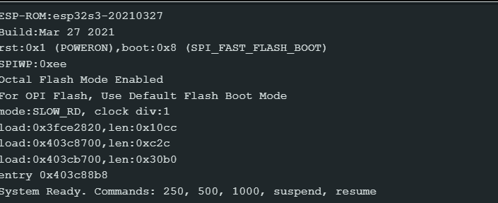
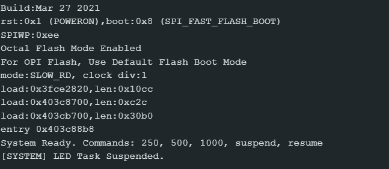
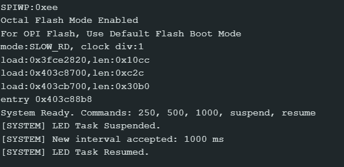

# FreeRTOS Task Control & State Management

## 1. Hardware and Software
* **Board:** ESP32-S3-DevKitC-1 v1.1
* **Onboard LED Pin:** GPIO 38 (Addressable RGB LED)
* **Development Environment:** Arduino IDE 2.x
* **Baud Rate:** 115200

---

## 2. Task Design
The application consists of two independent FreeRTOS tasks pinned to the same processor core:

* **Serial Task (Task A):** Reads input commands from the Serial Monitor, validates them (accepting `250`, `500`, `1000`, `suspend`, and `resume`), updates the shared `blinkInterval` variable, and manages the execution state of the LED task using task handles.
* **RGB LED Task (Task B):** Controls the onboard RGB LED on GPIO 38, toggling it ON and OFF using the latest accepted `blinkInterval` value.

### Configuration
* **Priorities:** Both tasks run at Priority 1.
* **Core Assignment:** Both tasks are pinned to Core 1 via `xTaskCreatePinnedToCore()`.

---

## 3. Task Handles
Task handles (`TaskHandle_t`) serve as unique reference variables created during task initialization. They allow one task to explicitly reference and control the execution state of another task via FreeRTOS kernel APIs.

~~~cpp
// Task handle declarations
TaskHandle_t serialTaskHandle = NULL;
TaskHandle_t ledTaskHandle = NULL;

// Store handles during task creation
xTaskCreatePinnedToCore(serialTask, "Serial Task", 2048, NULL, 1, &serialTaskHandle, 1);
xTaskCreatePinnedToCore(ledTask, "LED Task", 2048, NULL, 1, &ledTaskHandle, 1);

// Controlling task state using handle
vTaskSuspend(ledTaskHandle);
vTaskResume(ledTaskHandle);
~~~

---

## 4. Suspend / Resume Test
* **`suspend` Command:** Executing `vTaskSuspend(ledTaskHandle)` immediately stops the RGB LED Task. The LED stops toggling and freezes in its current state, while the Serial Task continues to run normally and respond to user commands.
* **`resume` Command:** Executing `vTaskResume(ledTaskHandle)` returns the RGB LED Task to service. The LED resumes blinking immediately, using the most recently accepted `blinkInterval`.

---

## 5. Prediction and Observation Table

| Situation | Prediction Before Test | Actual Observation | Match? Why? |
| :--- | :--- | :--- | :--- |
| **LED task running normally** | Both tasks execute concurrently without blocking each other; the LED blinks while Serial processes inputs. | The LED blinked periodically at the configured interval, and Serial inputs were read immediately. | **Yes.** Non-blocking `vTaskDelay()` calls allow both equal-priority tasks to share CPU time. |
| **LED task suspended** | The LED stops toggling immediately; the Serial Task remains completely functional. | The LED froze in its last state; Serial Task accepted and validated commands normally. | **Yes.** `vTaskSuspend()` removes the task from the scheduler's ready queue entirely. |
| **LED task resumed** | The LED starts toggling again using the latest valid interval setting. | The LED resumed blinking instantly without requiring a system reset or parameter loss. | **Yes.** `vTaskResume()` transitions the task back to the **Ready** state. |

---

## 6. Demonstration Screenshots
* **Screenshot 1 — Normal Operation:**  
  
* **Screenshot 2 — LED Task Suspended:**  
  
* **Screenshot 3 — LED Task Resumed:**  
  

---

## 7. State Analysis

### Situation 1 – Normal Operation
* **Serial Task:** **Blocked** (waiting in `vTaskDelay`) / **Running**
* **RGB LED Task:** **Blocked** (waiting in `vTaskDelay`) / **Running**
* **Explanation:** Both tasks alternate rapidly between **Running** and **Blocked** states. Calling `vTaskDelay()` places a task in the **Blocked** state, relinquishing CPU control so the other task can run.

### Situation 2 – LED Task Suspended
* **Serial Task:** **Blocked** / **Running**
* **RGB LED Task:** **Suspended**
* **Explanation:** Calling `vTaskSuspend(ledTaskHandle)` forces the RGB LED Task into the **Suspended** state. It is removed from the scheduler's candidate list and consumes zero CPU core cycles.

### Situation 3 – LED Task Resumed
* **Serial Task:** **Running** / **Blocked**
* **RGB LED Task:** **Ready** $\rightarrow$ **Running**
* **Explanation:** Calling `vTaskResume(ledTaskHandle)` transitions the task from **Suspended** to **Ready**. As soon as CPU time becomes available, the preemptive scheduler moves it into the **Running** state.

---

## 8. Reflection

Task handles act as pointer references managed by the FreeRTOS kernel to identify specific task instances. Without a task handle, application code cannot target a specific task to alter its behavior or state dynamically from another thread.

When `vTaskSuspend(ledTaskHandle)` is called, the scheduler transitions the target task into the **Suspended** state. In this state, the task is entirely removed from scheduler evaluation, freezing its execution state and consuming zero processor cycles.

Calling `vTaskResume(ledTaskHandle)` moves the task back into the **Ready** state. Being in the **Ready** state means the task is eligible to execute, and it transitions to the **Running** state as soon as the FreeRTOS scheduler allocates CPU core time to it.

The Serial Task continues working independently when the LED Task is suspended because FreeRTOS manages tasks as decoupled execution threads. Removing a task from the active queue does not stall other tasks on the core, provided active tasks use non-blocking API calls like `vTaskDelay()` to share processing time.