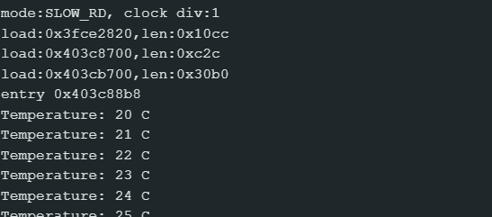

# FreeRTOS Queue Assignment

## 1. Purpose
This program demonstrates the FreeRTOS Producer-Consumer pattern using a data queue. It shows how data can be safely passed between two independent running tasks without using global variables.

## 2. How It Works
* **Sensor Task (Producer):** Initializes a temperature variable at 20. Every 1000 ms, it sends the current temperature integer into the FreeRTOS queue using `xQueueSend()` and then increments the value by 1.
* **Queue:** A FreeRTOS queue (`temperatureQueue`) created to safely store up to 5 integer values at a time.
* **Display Task (Consumer):** Continuously monitors the queue using `xQueueReceive()`. When data arrives, it pulls the integer out of the queue and prints it to the Serial Monitor.

## 3. Serial Monitor

## 4. Reflection
**Why is the queue useful in this program?**  
The queue is highly useful because it safely transfers data across task boundaries without the risk of race conditions or data corruption. It decouples the two tasks, meaning the Sensor Task can generate data at its own pace (every 1 second) while the Display Task can process it entirely independently.