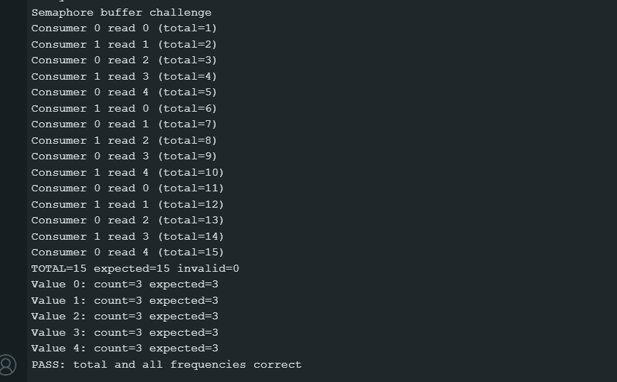
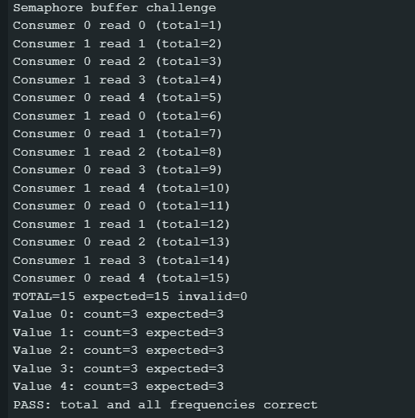

## Sharing a Buffer with Semaphores

# What does emptySlots count?

It counts free slots in memory to store values to.

# What does filledSlots count?

It counts how many slots are used in memory.

# What does the mutex protect?

Mutex makes sure, that tasks don't use memory at the same time.

# What did you change in the second test, and what happened?

I changed the consumer speed, which resulted in the same actions happening just slower, without memory errors, like in a queue. Producer had to wait for consumer to use the values in the memory.

# AI use

Confirmed my understanding of lecture material in my own words. Confirmed when I got the correct and expected results from the code.